# Syllo

**Every lesson marked. Every payment counted.**

Syllo is a management app for tutoring centers. It replaces the usual mix of WhatsApp messages and Excel sheets with one place for schedules, attendance, reschedule approvals and monthly tutor pay.

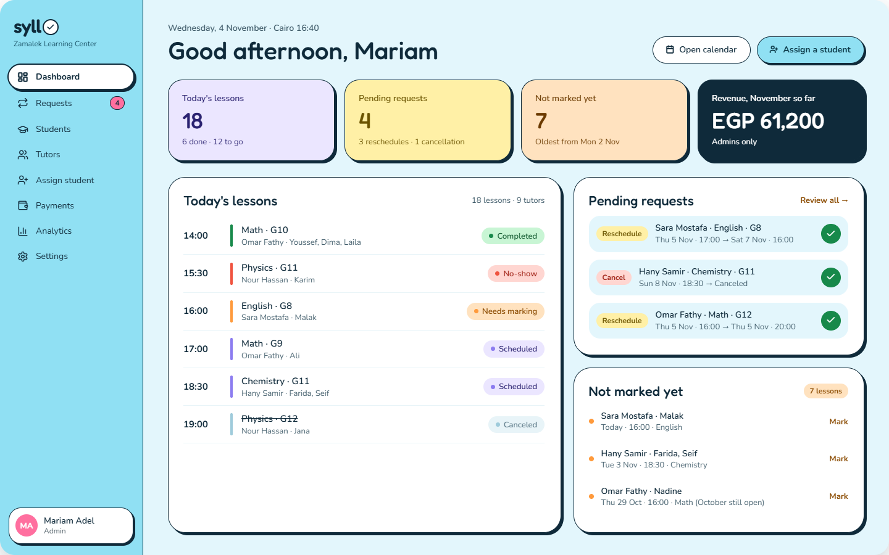

---

## Why Syllo?

Small tutoring centers usually run on group chats and spreadsheets:

- Tutors report attendance in chat messages that get buried.
- Reschedules are agreed informally, and no one knows which time is final.
- At month end, someone rebuilds every tutor's pay by hand from scattered notes.
- Price changes quietly rewrite last month's numbers.

Syllo gives each center a single source of truth:
- **Tutors** mark their own lessons.
- **Staff** approve every schedule change.
- **Monthly payment reports** build themselves and lock when the month ends.

---

## Features

### Three roles

| Capability | Admin | Assistant | Tutor |
|---|:-:|:-:|:-:|
| Manage tutors & students | ✅ | ✅ | |
| Manage assistants | ✅ | | |
| See prices, revenue & analytics | ✅ | | |
| Approve reschedule / cancel requests | ✅ | ✅ | |
| Mark lessons & submit change requests | ✅ | ✅ | ✅ own lessons |
| Edit availability | | | ✅ own only |
| See own pay | | | ✅ never the student price |
| Reopen a locked month | ✅ | | |

### For center staff

- **Dashboard.** Today's lessons, pending requests and lessons nobody has marked yet. Admins also see month-to-date revenue.
- **Change requests.** Every reschedule or cancellation goes through an approval queue. A built-in conflict check shows whether the tutor and students are free at the new time. Every decision is kept in the history.
- **Assign a student.** Filter tutors by subject, grade, school type and free time slots, pick one, and create a weekly schedule in a few clicks.
- **Students and tutors.** Profiles with contact details, school type and time zone, plus each student's weekly timetable.
- **Payment tables.** One grid per tutor per month, students × lesson dates, with totals for what was charged and what the tutor earns.
- **Analytics.** Revenue by subject and by tutor; completion, no-show and cancellation rates.
- **Price rules.** Set the student price and tutor pay for each Subject + Grade + School type + Duration. Lessons with no matching rule are flagged instead of silently going unbilled.

### For tutors

- **Personal dashboard.** Lessons waiting to be marked, what's coming up, and this month's pay.
- **Calendar.** Weekly and monthly views. Each lesson shows its students and the tutor's Google Meet link.
- **One-click marking.** Mark each student *Completed* or *No-show*. The pay counter updates instantly.
- **Availability editor.** Paint the hours you're free for new students.
- **My earnings.** The same monthly table staff see, showing only the tutor's own pay.

### Screens

| | |
|---|---|
| 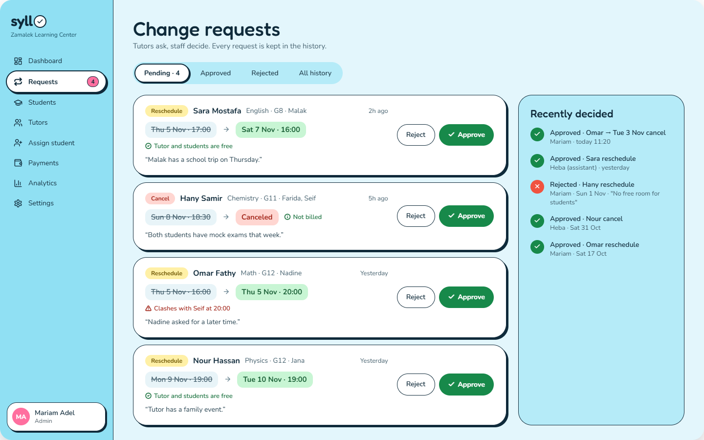 **Change requests** | 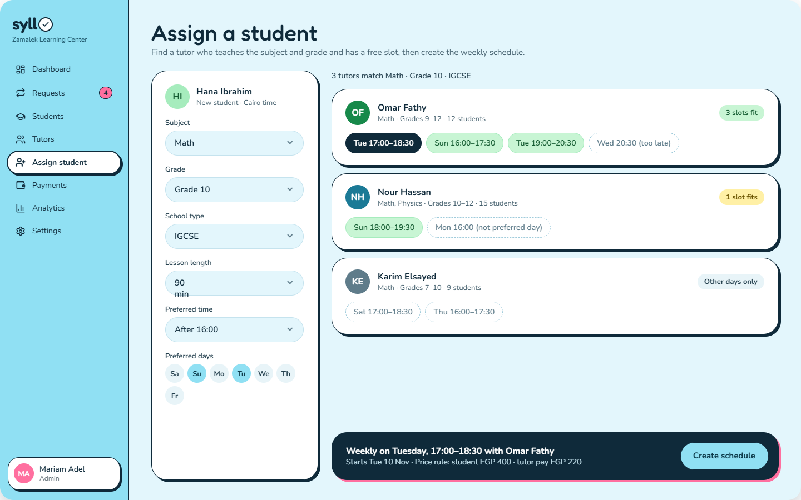 **Assign a student** |
| 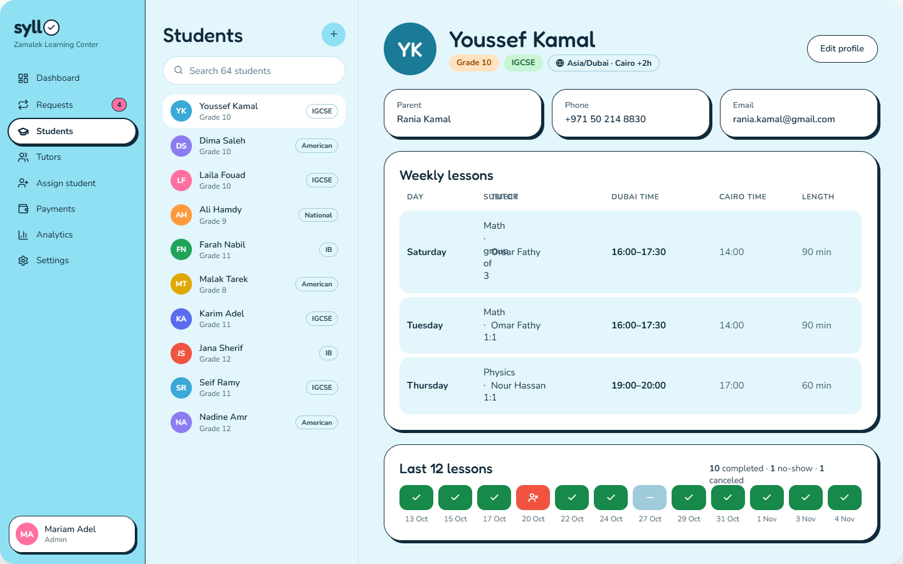 **Students** | 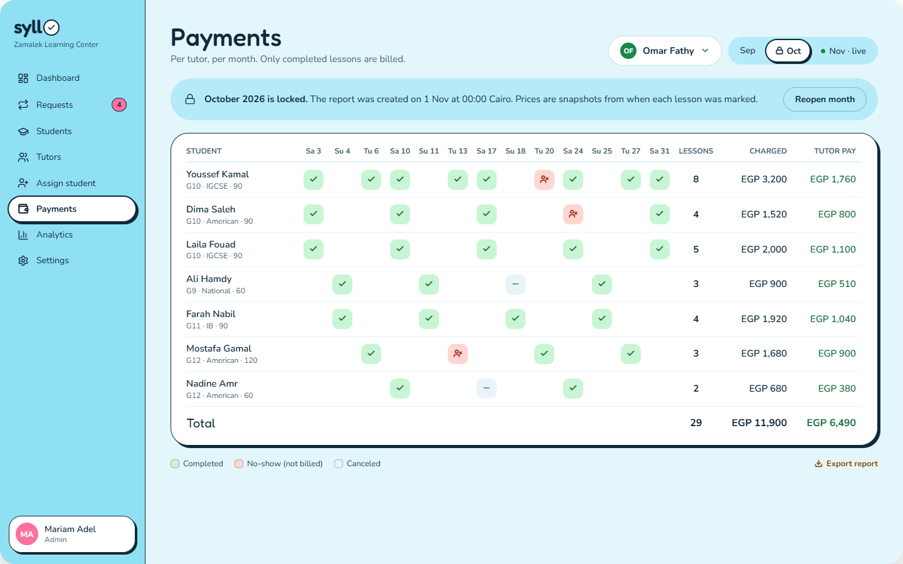 **Payment table** |
| 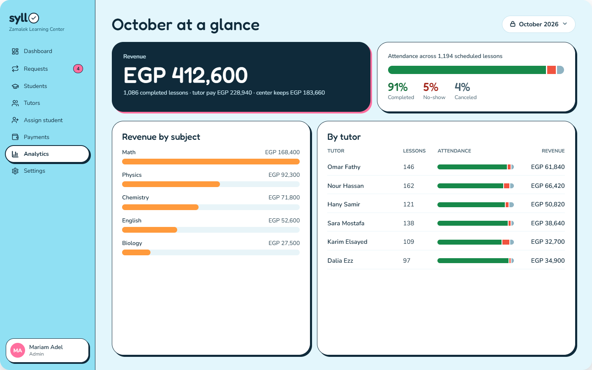 **Analytics** | 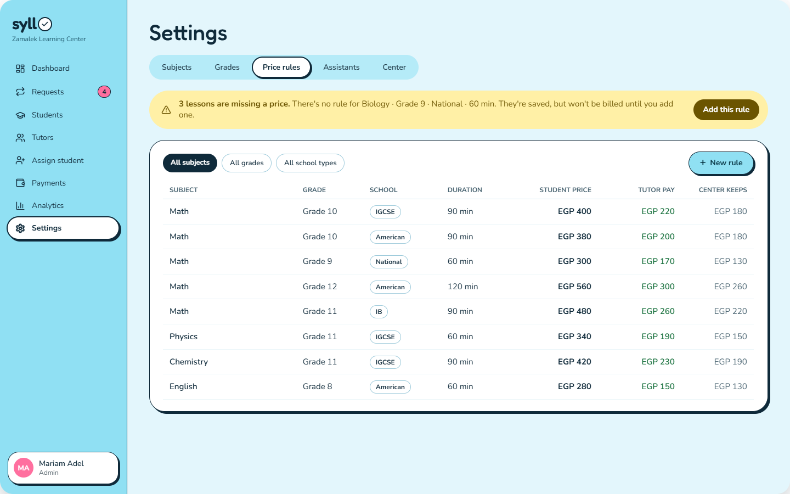 **Price rules** |
| 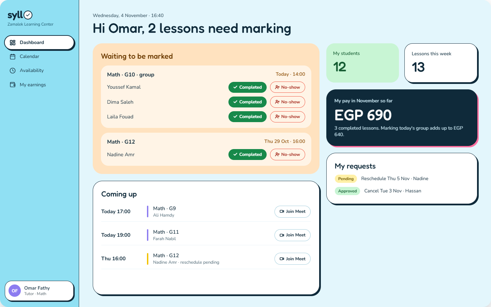 **Tutor dashboard** | 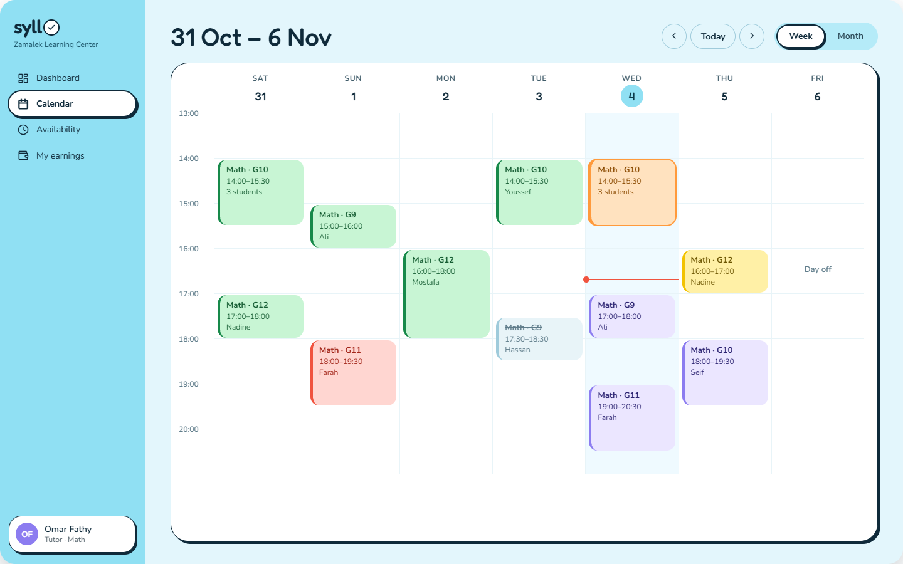 **Calendar** |
| 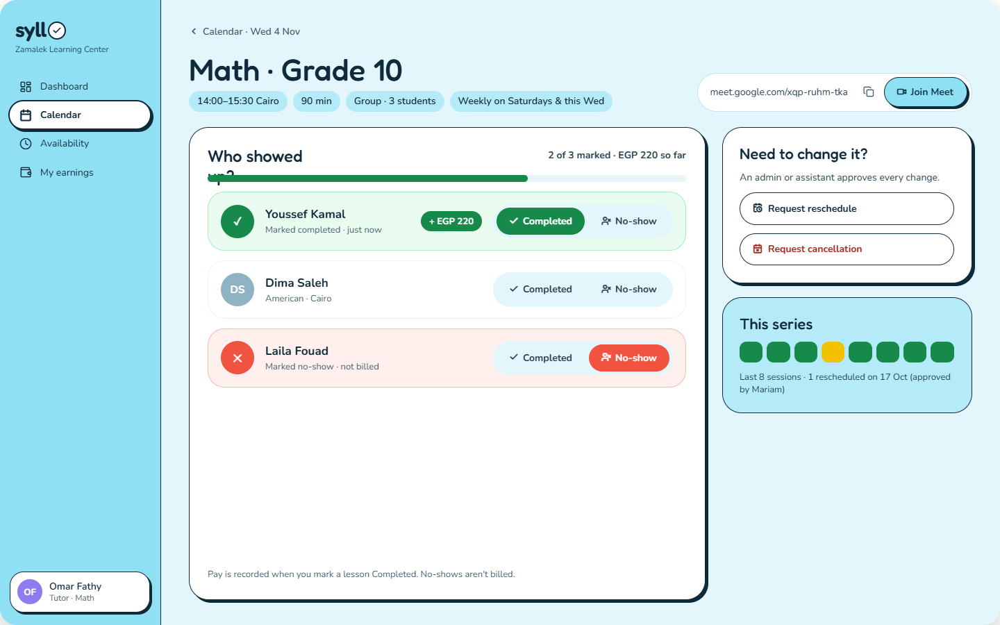 **Lesson detail & marking** | 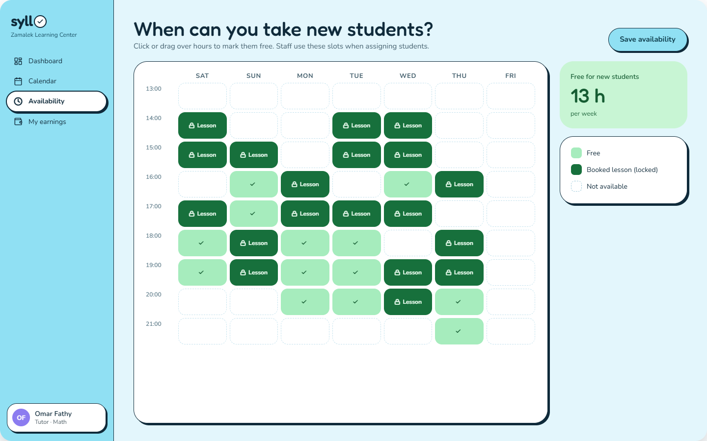 **Availability editor** |
| 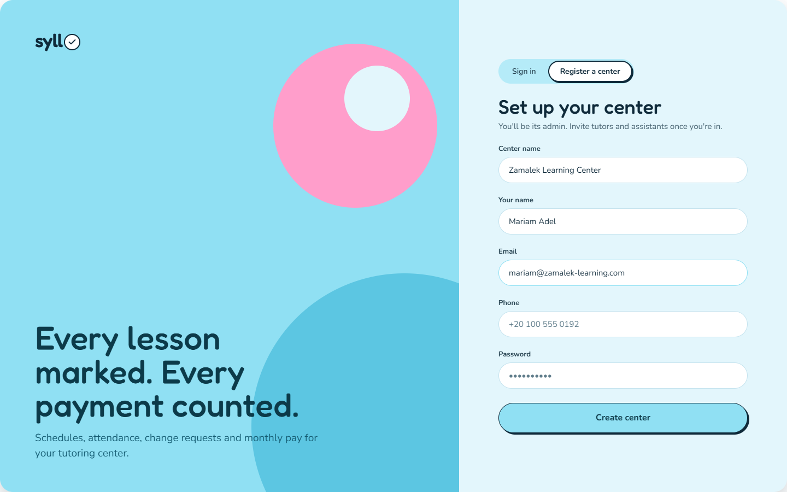 **Register a center** | |

---

## Business rules

These rules shape the data model and are enforced by the API, not just the UI.

- **Only completed lessons are billed.** No-shows and cancellations cost nothing.
- **Prices are snapshotted.** When a lesson is marked *Completed*, the current student price and tutor pay are copied onto that attendance record. Changing a price later never rewrites past months.
- **Group lessons are billed per student.** Each student pays their own price rule, and the tutor is paid for each student who attended.
- **Schedule changes need approval.** Tutors can't move or cancel lessons directly; they submit a request for staff to approve.
- **Months lock automatically.** When a month ends (in Cairo time), its reports are generated and locked. Only an admin can reopen one, and every change is written to an audit log.
- **Time zones are handled explicitly.** Times are stored in UTC. Staff see Cairo time; students see their own time zone with Cairo time alongside.
- **Centers are fully isolated.** Any center can sign up, and no center can see another's data.
- **Currency:** EGP throughout.

---

## Tech stack

| Layer | Technologies |
|---|---|
| **Frontend** | React 19, TypeScript, Vite, React Router, TanStack Query, Tailwind CSS v4, Lucide icons, FullCalendar, Recharts |
| **Backend** | NestJS, TypeScript, Prisma 7 (ORM), JWT authentication, bcrypt, class-validator |
| **Database** | PostgreSQL (local via Docker Compose) |
| **Testing** | Vitest, Supertest (e2e against a dedicated test database), Playwright (browser checks) |
| **Tooling** | oxlint, Prettier, GitHub CLI |
| **Hosting** | Vercel (web) · Render (API) · Neon (Postgres) |

---

### Frontend architecture

- **Design tokens.** The design's colors, fonts, radii and shadows are defined once in Tailwind's `@theme` and reused everywhere.
- **Reusable UI primitives:** Button, Card, StatusChip, SegmentedTabs, TextField, Avatar.
- **Client-side routing** with layout routes and route guards (`RequireAuth`, `RequireRole`).
- **A single page registry** drives both the sidebar and the route permissions, so a hidden link can never be a reachable URL.
- **Server state with TanStack Query:** caching, loading and error states, retries, and session restore on reload.
- **A central API client** that attaches the token, maps validation errors to form fields, and signs the user out when the token expires.
- **Accessible components:** labelled inputs, `aria-*` attributes and visible keyboard focus.

## Roadmap

Planned for v2:

- Notifications and reminders: new-student assignments, unmarked lessons, schedule changes, upcoming lessons
- Student and parent logins
- Payment collection status (paid / unpaid)

The data model is already designed to support all three.
